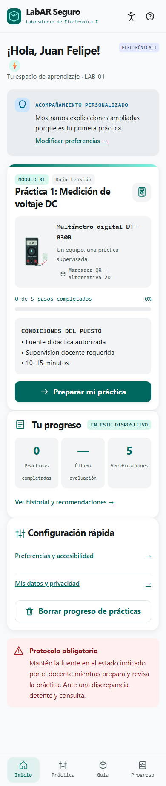
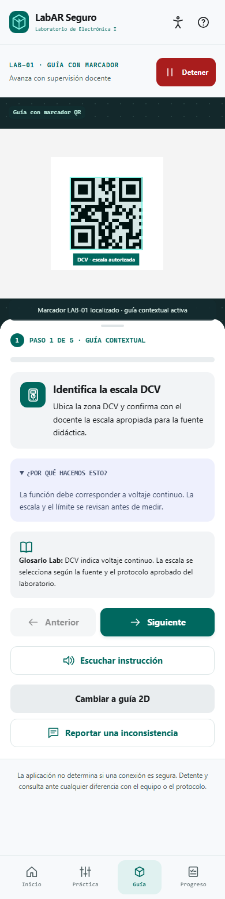
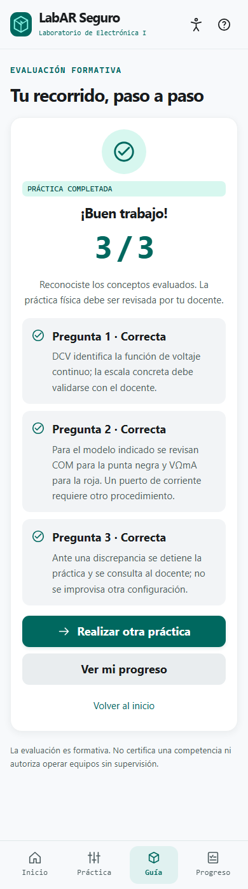
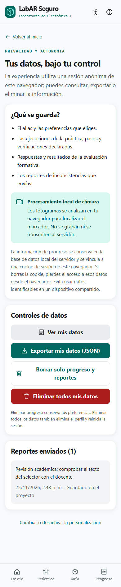

# LabAR Seguro
## Manual de usuario actualizado

**Fecha:** 25 de noviembre de 2026
**Autor:** Juan Felipe Jauregui Carrillo
**Acceso:** https://labar-theta.vercel.app

Este manual corresponde a la aplicación publicada en Vercel con almacenamiento PostgreSQL de Supabase. LabAR orienta una práctica supervisada de voltaje DC de baja tensión con multímetro DT-830B. No mide voltajes ni comprueba el cableado. La autorización y la supervisión corresponden al docente.

## 1. Acceder al sistema

Abrir https://labar-theta.vercel.app desde un navegador moderno con JavaScript y conexión a Internet. No es necesario instalar Node.js ni iniciar un servidor para usar esta versión publicada. Se puede acceder desde computador o teléfono. La guía 2D funciona sin cámara; para usar video se necesita una cámara compatible y autorizar su acceso.

La aplicación crea una sesión anónima mediante una cookie. Usar el mismo navegador y la misma dirección permite recuperar las preferencias y el progreso. No existe un inicio de sesión institucional ni recuperación de la sesión entre dispositivos. Borrar las cookies o cerrar una sesión de navegación privada puede hacer perder el acceso a los datos guardados. Conviene exportarlos antes.

Si la aplicación muestra un error de conexión, comprobar Internet y recargar. Si persiste, informar al responsable del proyecto. Un proyecto gratuito de Supabase inactivo puede requerir reactivación por su administrador.

## 2. Configurar la experiencia

En la bienvenida, seleccionar Configurar mi experiencia. Escribir un alias, indicar la experiencia con el multímetro y elegir las preferencias de presentación. Se puede activar texto grande, alto contraste, movimiento reducido y lectura en voz alta, según las opciones disponibles. Guardar para abrir el inicio.

La opción Continuar con guía estándar permite usar la aplicación sin personalización. Las preferencias pueden modificarse después desde el botón de accesibilidad del encabezado. La lectura utiliza la voz del navegador; su disponibilidad depende del dispositivo. La instrucción escrita siempre permanece disponible.

## 3. Preparar una práctica

1. Abrir la práctica del multímetro desde Inicio o Práctica y revisar el objetivo, los materiales y las condiciones.
2. Elegir la guía con cámara o la alternativa 2D.
3. Para usar cámara, permitir su acceso y mostrar el marcador QR de LabAR, impreso o en otra pantalla. El archivo está en `frontend/assets/marcador-labar.png` y puede abrirse en https://labar-theta.vercel.app/assets/marcador-labar.png.
4. Verificar personalmente que el equipo corresponde al modelo DT-830B y confirmar su coincidencia. Si no coincide, detener el procedimiento y consultar al docente.
5. Completar las cinco verificaciones preventivas que aparecen en pantalla. El botón para continuar se habilita al completarlas.

Reconocer el marcador identifica el contenido de la guía. No verifica físicamente el equipo, las puntas ni la conexión. Marcar casillas representa una declaración del estudiante; no sustituye la revisión del docente. No utilizar la guía para red eléctrica, alto voltaje ni procedimientos sin supervisión.

## 4. Seguir la guía y pausar

Avanzar por los cinco pasos en orden mediante el botón de continuación. Consultar las ayudas de cada paso y la lectura en voz alta cuando esté disponible. La API guarda el avance y exige completar la secuencia antes de evaluar.

En modo con cámara, mantener el QR completo y visible, con iluminación suficiente. La superposición visual orienta el aprendizaje y no realiza una medición ni un reconocimiento físico del cableado. Si se pierde el marcador, la aplicación pausa la guía. Se puede recuperar el marcador o continuar en 2D conservando el paso alcanzado.

El botón Detener permite pausar voluntariamente. Al reanudar una ejecución se conserva el avance, pero debe confirmarse nuevamente el equipo y completarse la lista preventiva. Si la cámara falla, usar guía 2D. También se puede cargar una imagen del marcador desde la opción correspondiente; la aplicación la procesa en el navegador y selecciona 2D.

## 5. Evaluar y consultar el historial

Al finalizar los cinco pasos, responder las tres preguntas y enviar la evaluación. Si falta una respuesta, completar la selección antes de continuar. El servidor calcula el puntaje de 0 a 3 y muestra los conceptos que conviene repasar.

En Progreso se pueden revisar las ejecuciones finalizadas y sus resultados. Recargar la página conserva el historial asociado con la cookie del navegador. Repetir la práctica genera una nueva ejecución. Las recomendaciones de personalización dependen del perfil y los resultados; se pueden desactivar desde Preferencias. El puntaje no constituye una certificación de competencias.

## 6. Reportar una inconsistencia

Desde la guía o el historial, seleccionar Reportar una inconsistencia. Describir el problema en entre 10 y 1000 caracteres y guardar. Evitar nombres, documentos, contraseñas u otros datos personales. El reporte queda asociado con la sesión y puede revisarse en Privacidad. Esta función no envía mensajes al docente; las consultas presenciales se realizan por el canal habitual del curso.

## 7. Consultar, exportar y eliminar datos

Abrir Mis datos y privacidad desde Progreso o desde el enlace de la bienvenida. Las imágenes de cámara se procesan localmente y no se envían a la API. El perfil, las ejecuciones y los reportes sí se almacenan en Supabase mediante la API privada del servidor.

| Opción | Resultado |
| --- | --- |
| Ver mis datos | Muestra los datos de la propia sesión. |
| Exportar mis datos | Descarga un archivo JSON con perfil, ejecuciones y reportes. No incluye el token de sesión. |
| Borrar solo progreso y reportes | Elimina ejecuciones y reportes; conserva preferencias. Requiere confirmación. |
| Eliminar todos mis datos | Elimina perfil, progreso y reportes de la sesión; reinicia la experiencia. Requiere confirmación. |

Cancelar el cuadro de confirmación conserva los datos. Las eliminaciones no pueden deshacerse desde la aplicación y no borran copias de seguridad externas. La sesión tiene vigencia de 30 días; los datos vencidos se purgan al inicializar la aplicación y las cookies vencidas se sustituyen al consultar la API.

## 8. Resolver dificultades frecuentes

| Situación | Acción |
| --- | --- |
| No aparece permiso de cámara | Abrir la dirección HTTPS publicada y revisar los permisos del sitio; usar 2D si es necesario. |
| No se reconoce el QR | Mostrar el marcador correcto completo, mejorar luz y enfoque, o cargar su imagen. |
| No se habilita continuar | Confirmar el modelo y completar las cinco verificaciones. |
| La guía se pausa | Revisar visibilidad del QR y reanudar; confirmar nuevamente equipo y lista cuando se solicite. |
| No se guarda un formulario | Revisar el mensaje, comprobar Internet y reintentar. Evitar cerrar la página mientras se guarda. |
| No aparece el historial | Comprobar que se utiliza el mismo navegador, dominio y cookie; no existe recuperación institucional. |
| La evaluación no se envía | Completar los cinco pasos y responder las tres preguntas. |
| No se escucha la voz | Revisar volumen y disponibilidad de voz del navegador; consultar el texto. |
| Servicio de base de datos no disponible | Informar al administrador; la comprobación técnica está en /api/health. |

## 9. Alcance de la comprobación

El 25 de noviembre de 2026 se verificaron 46 comprobaciones de navegador sobre el sitio publicado y 10 comprobaciones adicionales de la API en producción. Las capturas de este manual proceden de ese recorrido. El reconocimiento QR utilizó una cámara virtual; la cámara física y el procedimiento eléctrico requieren validación presencial en el laboratorio.
