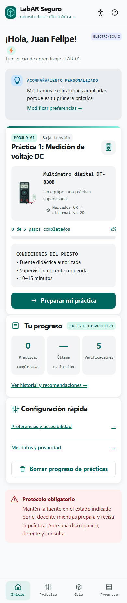
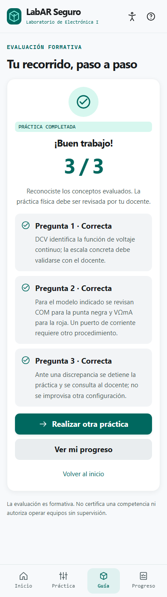
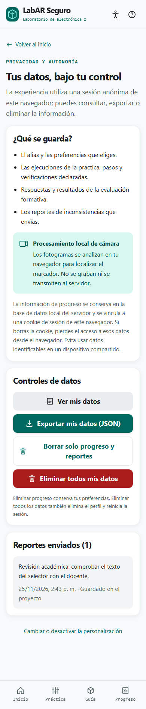
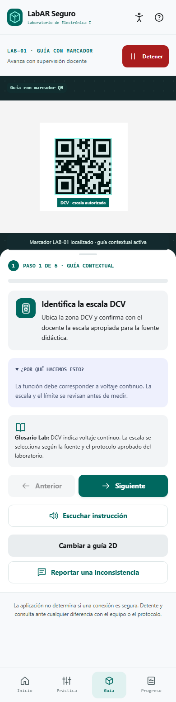
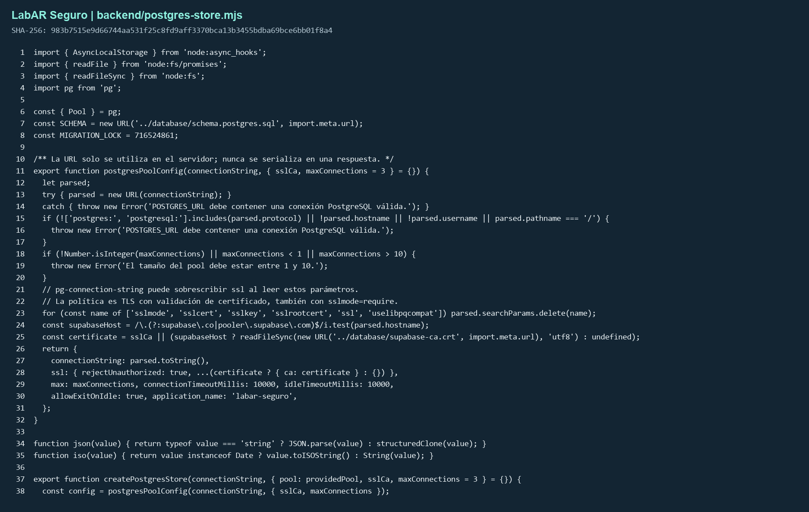
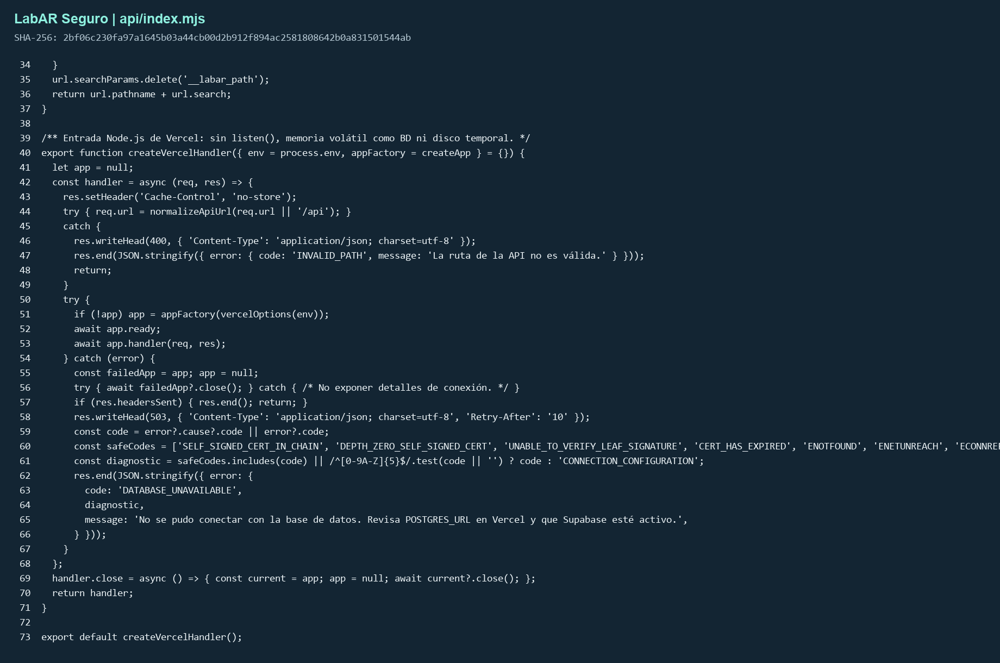

# LabAR Seguro
## Addendum técnico: Vercel y Supabase

**Asignatura:** Tecnologías Emergentes
**Estudiante:** Juan Felipe Jauregui Carrillo
**Docente:** Jenny Esmeralda Zabaleta
**Institución:** FESC – Fundación de Estudios Superiores Comfanorte
**Fecha de actualización:** 25 de noviembre de 2026
**Versión de la aplicación:** 1.0.0

Esta actualización documenta la adaptación de LabAR Seguro a una API serverless en Vercel y una base PostgreSQL de Supabase. Complementa los documentos del corte anterior conservados en docs/final/. La comprobación del despliegue se informa según las evidencias disponibles; no se supone que una compilación correcta demuestre por sí sola acceso real a la base de datos.

## 1. Alcance de la actualización

La aplicación conserva el propósito educativo: orientar una práctica supervisada de voltaje DC de baja tensión con un multímetro DT-830B. La interfaz, sus verificaciones, la guía de cinco pasos, la evaluación formativa, el historial y los controles de privacidad mantienen su contrato funcional.

El cambio se concentra en tres componentes: publicación del frontend, entrada de la API y persistencia remota. SQLite continúa disponible para ejecución local; PostgreSQL permite que distintas instancias de la API consulten y actualicen la misma base. Esta separación evita tratar el sistema de archivos temporal de una función como si fuera almacenamiento durable.

El estudiante confirmó que el recurso de Supabase está conectado al proyecto LabAR de Vercel, que POSTGRES_URL existe en Production y Preview, y que la base remota es nueva y está vacía. La URL pública de Supabase es https://elzvijaeofempysspsvr.supabase.co. Las credenciales privadas no se incorporan al repositorio ni a este documento.

## 2. Incidente de publicación que motivó el cambio

El despliegue inicial respondía 404 NOT_FOUND en la ruta raíz. Durante el diagnóstico, /frontend/index.html respondía 200, mientras /api/health respondía 404. Los resultados mostraron que el contenido del repositorio se había publicado sin convertir frontend/ en la raíz de los recursos y sin desplegar una entrada compatible para la API.

Configurar únicamente la carpeta del frontend habría permitido encontrar el HTML, CSS y JavaScript, pero la interfaz utiliza /api/bootstrap antes de mostrar su recorrido. Por ello, la solución requiere tanto los recursos públicos como una función que atienda las rutas de la API.

## 3. Arquitectura y responsabilidades

| Componente | Responsabilidad | Persistencia o destino |
| --- | --- | --- |
| Navegador | Presentar pantallas, preferencias, guía y evaluación; procesar cámara/QR. | No guarda fotogramas en el servidor. |
| public/ | Recursos generados por el build a partir del frontend. | Salida pública regenerable de Vercel. |
| api/index.mjs | Recibir solicitudes serverless y encaminarlas a la API. | Comparte el mismo dominio que el frontend. |
| backend/app.mjs | Validar sesión, datos, origen, secuencia y condiciones de interacción. | Utiliza el adaptador de almacenamiento configurado. |
| backend/postgres-store.mjs | Ejecutar consultas parametrizadas, inicializar esquema y controlar transacciones. | PostgreSQL remoto mediante conexión privada. |
| database/schema.postgres.sql | Definir tablas, claves, índices y protección de acceso. | Esquema public con tablas prefijadas labar_. |
| backend/store.mjs | Mantener la alternativa de ejecución local. | Archivo SQLite local configurado por DB_PATH. |

El procesamiento de cámara permanece en el dispositivo. jsQR localiza el marcador LABAR:DT830B:V1 y la guía muestra una referencia contextual. Este despliegue no añade lectura automática del multímetro, diagnóstico eléctrico ni certificación de seguridad.

## 4. Configuración de Vercel

El repositorio contiene vercel.json para definir la publicación. La raíz del proyecto debe ser la raíz del repositorio, no frontend/. El framework se configura como Other; el comando de compilación es npm run build y el directorio de salida es public. El script scripts/build-vercel.mjs prepara exclusivamente los recursos del frontend para la salida pública y mantiene el código de servidor y los documentos fuera de esa carpeta.

La API se publica desde api/index.mjs y atiende las rutas /api/*. No depende de abrir un puerto mediante server.listen() dentro de una función. La ejecución local continúa utilizando backend/server.mjs y npm start.

| Variable | Uso | Tratamiento |
| --- | --- | --- |
| POSTGRES_URL | Conexión PostgreSQL suministrada por la integración Supabase–Vercel. | Privada; únicamente backend. |
| DATABASE_URL | Alternativa de conexión admitida cuando no se proporciona POSTGRES_URL. | Privada; únicamente backend. |
| POSTGRES_SSL_CA | Certificado de autoridad en formato PEM cuando la conexión lo requiera. | Configuración del servidor; no desactiva la validación TLS. |
| PUBLIC_ORIGIN | Origen público explícito para validar solicitudes. | Solo protocolo, dominio y puerto, sin credenciales ni rutas. |
| VERCEL_PROJECT_PRODUCTION_URL / VERCEL_URL | Identificar los dominios de producción y preview suministrados por Vercel. | Se usan en la configuración segura del adaptador. |
| DB_PATH | Ruta de SQLite para una ejecución local explícita. | No constituye almacenamiento persistente de Vercel. |

Las cookies de la instalación HTTPS usan el atributo Secure, además de HttpOnly y SameSite. Las mutaciones conservan la validación del origen y de la cabecera X-LabAR-Client. El frontend no recibe contraseñas ni claves privilegiadas de Supabase.

## 5. Esquema e inicialización de PostgreSQL

El script database/schema.postgres.sql es idempotente para una instalación nueva: utiliza CREATE TABLE IF NOT EXISTS e índices con nombres propios. Se aplica antes de operar con los registros y protege la inicialización simultánea mediante un bloqueo transaccional de migración. También puede ejecutarse explícitamente con el siguiente comando desde un entorno privado ya configurado:

```powershell
node backend/migrate.mjs
```

El comando toma POSTGRES_URL o, como alternativa, DATABASE_URL del entorno. La cadena de conexión no se escribe en la consola. Si existe un problema, se emite un mensaje de operación sin copiar el valor secreto ni mensajes externos que pudieran contenerlo.

La migración inicial crea labar_sessions, labar_attempts y labar_issues. El modelo físico y su diccionario se entregan en el documento Modelo_Base_de_Datos_LabAR_Seguro, generado desde modelo_fuente.md. La práctica y sus preguntas continúan siendo contenido versionado del backend; el perfil se almacena dentro de profile_json de la sesión, no en una cuarta tabla física.

La inicialización del esquema no copia automáticamente registros de archivos SQLite anteriores. Esa copia no resulta necesaria para esta instalación, porque se confirmó una base nueva y vacía. Una migración de datos existentes requeriría un procedimiento específico de exportación, transformación y validación.

## 6. Integridad, concurrencia y acceso

Las consultas PostgreSQL son parametrizadas. Las mutaciones de la misma sesión se coordinan mediante transacciones y bloqueo de su fila para evitar que dos instancias sobrescriban preferencias, creen varias ejecuciones abiertas o guarden dos resultados incompatibles. Un índice único parcial impide más de una ejecución no completada por sesión.

La clave foránea owner relaciona cada ejecución y reporte con la sesión. El borrado de la sesión elimina sus registros dependientes mediante ON DELETE CASCADE. El borrado exclusivo del progreso conserva el perfil y elimina ejecuciones y reportes dentro de una transacción.

El esquema activa Row Level Security en las tres tablas y no proporciona políticas de acceso a los roles públicos de Supabase. También revoca permisos directos de anon y authenticated cuando esos roles existen. El navegador utiliza la API de LabAR con su cookie; no consulta estas tablas mediante una clave pública. La conexión privada del backend debe disponer de permisos para crear y operar sus tablas.

La conexión utiliza TLS con validación de certificado. No se utiliza rejectUnauthorized=false como solución de conexión. El pool predeterminado contiene un máximo de tres conexiones por instancia y la aplicación no configura sentencias preparadas con nombre, para adecuarse al pooler transaccional.

Para los hosts oficiales de Supabase se incluye la autoridad pública Supabase Root 2021 CA en `database/supabase-ca.crt`, descargada mediante HTTPS desde https://supabase-downloads.s3.amazonaws.com/prod/ssl/prod-ca-2021.crt. Su huella SHA-256 es `807025ad50d4ed219d2c9c7d299c004f824eb00cf7f65afef607d07b72e6cafa` y vence el 26 de abril de 2031. Este certificado es público y no contiene contraseñas ni claves privadas. `POSTGRES_SSL_CA` permite sustituirlo si el proveedor cambia su autoridad. Los demás servidores conservan la validación de las autoridades predeterminadas de Node, salvo configuración explícita.

Los tokens de sesión se generan aleatoriamente y solo se guarda su hash. Una sesión continúa representando un navegador, no una cuenta institucional. La integración de Supabase en esta etapa añade persistencia remota; no incorpora por sí sola registro de estudiantes, inicio de sesión institucional o recuperación entre dispositivos.

## 7. Puesta en marcha y comprobación

1. Verificar que el proyecto Supabase esté activo y que el recurso esté conectado al proyecto correcto de Vercel.
2. Confirmar que POSTGRES_URL esté habilitada para el entorno que se despliega. Mantener su valor oculto.
3. Desplegar el commit con vercel.json y la entrada de API. Revisar el build y los logs sin copiar credenciales.
4. Abrir la raíz del sitio y consultar /api/health. La salud debe acreditar el almacenamiento remoto antes de afirmar que la conexión está operativa.
5. Completar una práctica con una sesión de prueba: preferencias, confirmación, lista, guía y evaluación.
6. Recargar y comprobar persistencia del perfil, progreso o resultado según el estado de la ejecución.
7. Probar reporte, exportación y borrado con la misma sesión de prueba; no eliminar registros ajenos.

Las pruebas funcionales no requieren operar un circuito real. El acceso a cámara necesita HTTPS y permiso explícito; la guía 2D conserva el contenido cuando la cámara no está disponible.

## 8. Operación, respaldo y reversión

Antes de cambios estructurales futuros, conservar un respaldo de las tablas de LabAR mediante las herramientas autorizadas de Supabase o PostgreSQL. Las credenciales de respaldo son privadas. El plan gratuito y sus políticas pueden cambiar; verificar las opciones de exportación y recuperación disponibles para la cuenta antes de una entrega importante.

Supabase puede pausar proyectos gratuitos por baja actividad. Si la API deja de responder después de un periodo sin uso, comprobar el estado del proyecto antes de atribuirlo a un error de navegación. También revisar que las variables existan en el entorno correcto y que el pooler, TLS y los permisos de la base estén configurados.

La reversión del código debe utilizar un commit o deployment conocido y compatible con el esquema. Este script inicial no borra tablas ni contiene un procedimiento destructivo de reversión. Volver a publicar el commit anterior con SQLite local no convierte su archivo en almacenamiento durable de Vercel ni restaura automáticamente los datos remotos.

Si hace falta detener la instalación, evitar borrar las tablas como primer paso de diagnóstico. Registrar el error, conservar el respaldo y limitar cualquier reparación a los datos y recursos del proyecto. Las operaciones Eliminar progreso y Eliminar todos mis datos actúan sobre los registros de la sesión; no destruyen respaldos externos.

## 9. Verificaciones de esta actualización

{{RESULTADOS}}

Las cifras del corte anterior —31 pruebas Node y 46 comprobaciones de navegador— permanecen en docs/final/ como evidencia histórica. Esta actualización no modifica retroactivamente esos resultados ni los presenta como prueba de conexión remota. Las pruebas nuevas se deben identificar por entorno: SQLite, PostgreSQL aislado, adaptación Vercel y comprobación HTTP en producción, según lo efectivamente ejecutado.

## 10. Límites que se conservan

- La aplicación no certifica conexiones, seguridad eléctrica ni competencias del estudiante.
- La lectura de un QR identifica la guía y no demuestra que el instrumento físico o el cableado sean correctos.
- La sesión anónima no equivale a una identidad académica verificada.
- El despliegue no demuestra mejora de aprendizaje; esa hipótesis requiere un piloto autorizado.
- El software puede comprobarse con fuentes de cámara virtuales, pero su rendimiento físico debe revisarse en los dispositivos del laboratorio.

## 11. Archivos y referencias

| Archivo | Finalidad |
| --- | --- |
| vercel.json | Publicación de recursos y configuración del proyecto. |
| api/index.mjs | Entrada de funciones para Vercel. |
| scripts/build-vercel.mjs | Generación de recursos públicos del frontend. |
| backend/postgres-store.mjs | Persistencia remota, TLS, pool y transacciones. |
| backend/migrate.mjs | Inicialización explícita del esquema remoto. |
| database/schema.postgres.sql | Creación de tablas, índices y protección en PostgreSQL. |
| database/schema.sqlite.sql | Creación del esquema local. |
| docs/despliegue-supabase/ | Guía, modelo físico y evidencias del nuevo corte. |

Referencias oficiales consultadas para esta adaptación:

- Supabase. Vercel Marketplace. https://supabase.com/docs/guides/integrations/vercel-marketplace
- Supabase. Serverless drivers. https://supabase.com/docs/guides/database/connecting-to-postgres/serverless-drivers
- Supabase. Row Level Security. https://supabase.com/docs/guides/database/postgres/row-level-security
- Supabase. Project Pausing. https://supabase.com/docs/guides/platform/free-project-pausing
- Vercel. Static Configuration with vercel.json. https://vercel.com/docs/project-configuration/vercel-json
- Vercel. Node.js Functions. https://vercel.com/docs/functions/runtimes/node-js

## 12. Evidencias del despliegue y del desarrollo

Las siguientes capturas proceden del recorrido automatizado sobre https://labar-theta.vercel.app con PostgreSQL remoto. Los resultados detallados se conservan en `resultado_e2e.json`, `resultado_produccion.json` y `resultado_node.xml`. La cámara utilizada en la automatización es virtual; estas capturas no demuestran una prueba con cámara física.









Las dos imágenes de código siguientes son reproducciones legibles de archivos reales del repositorio, con ruta, numeración de líneas y hash SHA-256. No son capturas de un editor ni contienen credenciales.




